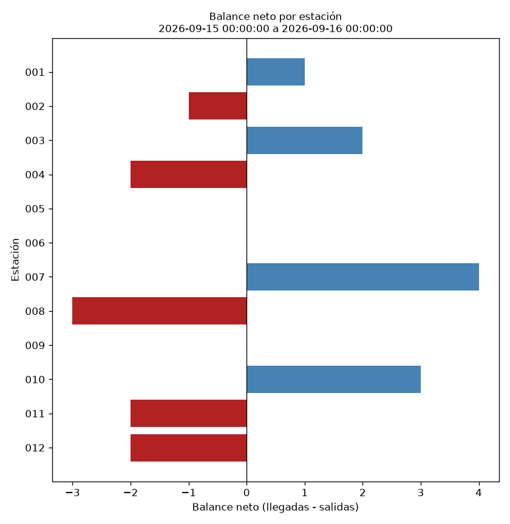

Reporte operativo de movimientos de Ecobici

Programación Orientada a Datos – Licenciatura en Ciencia de Datos – UCA 2026

Trabajo Práctico 2 (individual)

Alumna: Ernestina Berthet

1. Problema
Quien revisa la operación de una red de bicicletas públicas necesita saber, para un período
determinado, cuántas bicicletas salieron de cada estación y cuántas llegaron. Los registros de
viajes pueden venir incompletos o inconsistentes (sin estación de origen o destino, con
fechas imposibles, con un fin anterior al inicio o con identificadores repetidos) y, si se
cuentan sin controlarlos, alteran los balances.

2. Usuario y solución propuesta
Usuario: persona que analiza la operación de la red y necesita un reporte repetible por
estación y franja temporal.
Solución: una aplicación de consola en Python que:
carga viajes desde un archivo CSV o JSON;
valida cada registro y aparta los inválidos con el motivo del rechazo;
selecciona los viajes cuyo inicio cae dentro del período pedido;
registra, para cada viaje seleccionado, una salida en la estación de origen y una
llegada en la de destino;
genera un reporte por estación con salidas, llegadas y balance neto (llegadas − salidas).

3. Alcance de la primera versión
Incluye: lectura de CSV y JSON, validación con registro de rechazos, selección de período por
inicio del viaje, balance por estación, pruebas automatizadas, exportación del reporte y un gráfico.
No incluye: stock de bicicletas disponible (el balance no tiene inventario inicial ni
reposiciones), duración o distancia de los viajes, ni interfaz gráfica o web.

4. Funcionalidades y modo de uso
La aplicación se maneja con un menú de consola: al ejecutarla hace cinco preguntas, y en las que
tienen un valor por defecto entre corchetes alcanza con apretar Enter.
Pregunta	Qué se responde	Valor por defecto
Archivo de viajes	Ruta de un `.csv` o `.json` (el formato se elige por la extensión)	`data/viajes.csv`
Desde	Inicio del período, incluido: `AAAA-MM-DD` o `AAAA-MM-DD HH:MM:SS`	(obligatorio)
Hasta	Fin del período, excluido, en el mismo formato	(obligatorio)
Carpeta de salida	Dónde se guardan los resultados	`outputs`
¿Generar el gráfico?	`s` para dibujar el balance neto por estación, `n` para omitirlo	`n`
El período es el intervalo [desde, hasta): un viaje que empieza exactamente en `hasta` no entra.
Un viaje se asigna al período por su hora de inicio y se cuentan ambos extremos aunque termine
después del fin del período. Si algún dato es inválido (archivo inexistente, fecha que no existe,
período al revés), el programa informa el motivo con un mensaje claro.

5. Datos
Son datos simulados con la estructura de un registro de viajes de bicicletas públicas; no son
viajes reales de Ecobici. Se generan con `python -m src.generar_muestra` (semilla fija). La fuente,
el procedimiento, la licencia, las variables y las limitaciones están en
`data/README.md`.
Unidad de análisis: en la entrada, un viaje por fila; en el reporte, una estación por fila.
Volumen: 413 registros (400 correctos y 13 con errores deliberados), 12 estaciones y 5 variables
(mínimo pedido: 50 observaciones y 3 variables).

6. Instalación y ejecución
Requisitos: Python 3.10 o superior. Todos los comandos se ejecutan desde la carpeta raíz del proyecto.
```bash
# 1) Crear y activar un entorno virtual
python -m venv .venv
.venv\Scripts\activate          # Windows
source .venv/bin/activate       # macOS / Linux

# 2) Instalar las dependencias
pip install -r requirements.txt

# 3) Ejecutar la aplicación (en macOS/Linux puede hacer falta usar python3)
python -m src.main

# 4) Ejecutar las pruebas
python -m unittest discover -s tests -t .

# Opcional: regenerar los datos de ejemplo
python -m src.generar_muestra
```
Versiones con las que se desarrolló y probó: Python 3.11, pandas 3.0 y Matplotlib 3.10.
Antes de entregar conviene comprobar las versiones instaladas con `pip freeze`.
Ejemplo de uso. Al ejecutar `python -m src.main` el programa pregunta y se responde así
(lo escrito después de los dos puntos es lo que ingresa la persona):
```text
Archivo de viajes (.csv o .json) [data/viajes.csv]:                      <- Enter
Desde, incluido (AAAA-MM-DD o AAAA-MM-DD HH:MM:SS): 2026-09-15
Hasta, excluido (AAAA-MM-DD o AAAA-MM-DD HH:MM:SS): 2026-09-16
Carpeta de salida [outputs]:                                             <- Enter
¿Generar el gráfico? (s/n) [n]: s
```
Para consultar la franja de 7 a 10 h del 15/09 con el archivo JSON, se responde `data/viajes.json`,
`2026-09-15 07:00:00` y `2026-09-15 10:00:00`.

7. Organización del código
```text
TP2_BERTHET/
|-- README.md
|-- requirements.txt
|-- .gitignore
|-- src/
|   |-- main.py              # menú de consola: preguntas, ejecución, guardado y mensajes de error
|   |-- fuentes.py           # FuenteDatos (abstracta), FuenteCSV, FuenteJSON, crear_fuente()
|   |-- dominio.py           # ErrorDatos, regex, calendario, Periodo y BalanceEstacion
|   |-- pipeline.py          # validación, período, movimientos, balance, exportación y aplicación
|   |-- visualizacion.py     # gráfico del balance neto por estación
|   `-- generar_muestra.py   # generador de los datos simulados
|-- tests/                   # pruebas con unittest
|-- data/                    # viajes de ejemplo (CSV y JSON) y su documentación
`-- outputs/                 # resultados de la ejecución de ejemplo
```
Flujo: leer → inspeccionar y validar → seleccionar período → registrar movimientos → generar
balance → verificar → comunicar.
Paradigmas y conceptos del curso aplicados
El programa combina paradigmas, cada uno donde aporta claridad, control del estado y facilidad de prueba.
Concepto	Dónde y por qué
Programación estructurada y funciones con contrato	`validar_recorridos`, `seleccionar_periodo`, `registrar_movimientos`, `generar_balance` y `verificar_balance` tienen una responsabilidad cada una. Sus docstrings indican entradas, salida, efectos y errores
Estilo funcional y control del estado	Las funciones de transformación no modifican sus argumentos (trabajan sobre copias y devuelven tablas nuevas), lo que evita el aliasing. Los efectos (leer y escribir archivos, imprimir) quedan en los bordes: las fuentes, `guardar_*` y `main`
Clase del dominio con encapsulamiento	`BalanceEstacion` guarda sus contadores como estado interno; solo cambian con `registrar_salida()` y `registrar_llegada()`, y `salidas`, `llegadas` y `balance` son propiedades de solo lectura. `Periodo` es inmutable (`frozen=True`) y valida que `desde < hasta` al construirse (invariante)
Abstracción y dos implementaciones	`FuenteDatos.cargar()` es el contrato común; `FuenteCSV` y `FuenteJSON` lo implementan y devuelven la misma representación. El resto del programa no sabe de qué formato viene el dato
Composición e inyección de dependencia	`AplicacionEcobici` tiene una fuente que recibe por el constructor (relación "tiene un", no herencia), así que se puede cambiar o simular sin tocar la lógica
Expresiones regulares	`V[0-9]{5}` (identificador de viaje), `[0-9]{3}` (estación) y `AAAA-MM-DD HH:MM:SS` (fecha) validan la forma. No alcanzan solos: la fecha se completa con `strptime` (calendario) y la regla "fin posterior al inicio" y la unicidad del identificador se comprueban aparte
Errores con mensajes claros	`ErrorDatos` para problemas de la entrada; el menú de `main` los captura e informa el motivo sin mostrar el traceback

8. Decisiones de limpieza
Los registros inválidos no se descartan en silencio: se guardan en `outputs/rechazos.csv` con la
columna `motivo`, y la auditoría cumple `entrada = válidos + rechazados` y
`válidos = en el período + fuera del período`.
Regla	Qué se hace	Por qué
Identificador de viaje con mala forma	Se rechaza el registro	La forma `V` + 5 dígitos identifica el viaje
Identificador duplicado	Se conserva la primera aparición y se rechazan las siguientes	Un mismo viaje contado dos veces alteraría el balance
`inicio` o `fin` faltante, con otro formato o inexistente en el calendario	Se rechaza	Sin fechas válidas no se puede ubicar el viaje en un período
`fin` anterior o igual al `inicio`	Se rechaza ("tiempos incompatibles")	Un viaje con duración nula o negativa es un error de registro
Estación de origen o destino faltante o con mala forma	Se rechaza	Sin ambos extremos no se puede registrar la salida y la llegada. No se rellena ni se asume cero
Origen igual al destino	Se acepta	Es un viaje circular: suma una salida y una llegada en la misma estación
Espacios alrededor de un valor o campo vacío	Se recortan los espacios; un campo vacío cuenta como faltante	El CSV (campo vacío) y el JSON (`null`) se tratan igual
Tabla vacía, columnas ausentes, JSON mal formado, archivo inexistente, ningún viaje válido, período inválido	Se detiene el flujo con un error	Es un problema de toda la entrada, no de un registro
Además, `verificar_balance` comprueba que el resultado cumpla propiedades: la suma de salidas y la
de llegadas son iguales a la cantidad de viajes seleccionados, la suma de los balances netos es cero
y cada balance neto es llegadas − salidas.

9. Ejemplo de resultado
Salida de `python -m src.main` con las respuestas del ejemplo de uso (todo el día 15/09 y gráfico):
```text
Período: 2026-09-15 00:00:00 a 2026-09-16 00:00:00
Entrada: 413 registros | válidos: 400 | rechazados: 13 | viajes en el período: 57
estacion  salidas  llegadas  balance_neto
     001        3         4             1
     002        3         2            -1
     003        4         6             2
     004        9         7            -2
     005        7         7             0
     006        6         6             0
     007        3         7             4
     008        5         2            -3
     009        6         6             0
     010        1         4             3
     011        5         3            -2
     012        5         3            -2
```
Archivos generados en `outputs/`: `balance_<desde>_<hasta>.csv` (uno por período consultado),
`rechazos.csv` y `balance_estaciones.png`. La carpeta incluye también el reporte de la franja
del 15/09 de 7 a 10 h, consultada con `data/viajes.json`.


10. Interpretación y limitaciones
Cómo se lee el reporte. El balance neto es llegadas − salidas en el período. Un valor positivo
indica una estación que recibió más bicicletas de las que salieron (007: +4, 010: +3); uno negativo,
una que perdió (008: −3). La suma de la columna es siempre 0, porque cada viaje seleccionado aporta una
salida y una llegada.
Limitaciones.
El balance no es el stock disponible: no incluye el inventario inicial de cada estación ni las
reposiciones que hace el sistema. Una estación con balance −3 no necesariamente se quedó sin bicicletas.
Los datos son simulados: sirven para probar la aplicación, no permiten concluir nada sobre la
operación real de Ecobici. Con pocos viajes por período (57 en el día, 19 en la franja de la mañana)
los balances fluctúan mucho.
Un viaje se asigna al período por su hora de inicio; si termina después, su llegada igual se cuenta
en el período de la salida.
Las expresiones regulares validan solo la forma; las fechas, la unicidad y la relación entre `inicio`
y `fin` necesitan comprobaciones adicionales.
`rechazos.csv` conserva los registros originales; un valor faltante aparece como campo vacío.
No se consideran zonas horarias ni cambios de horario: se asume una única hora local.